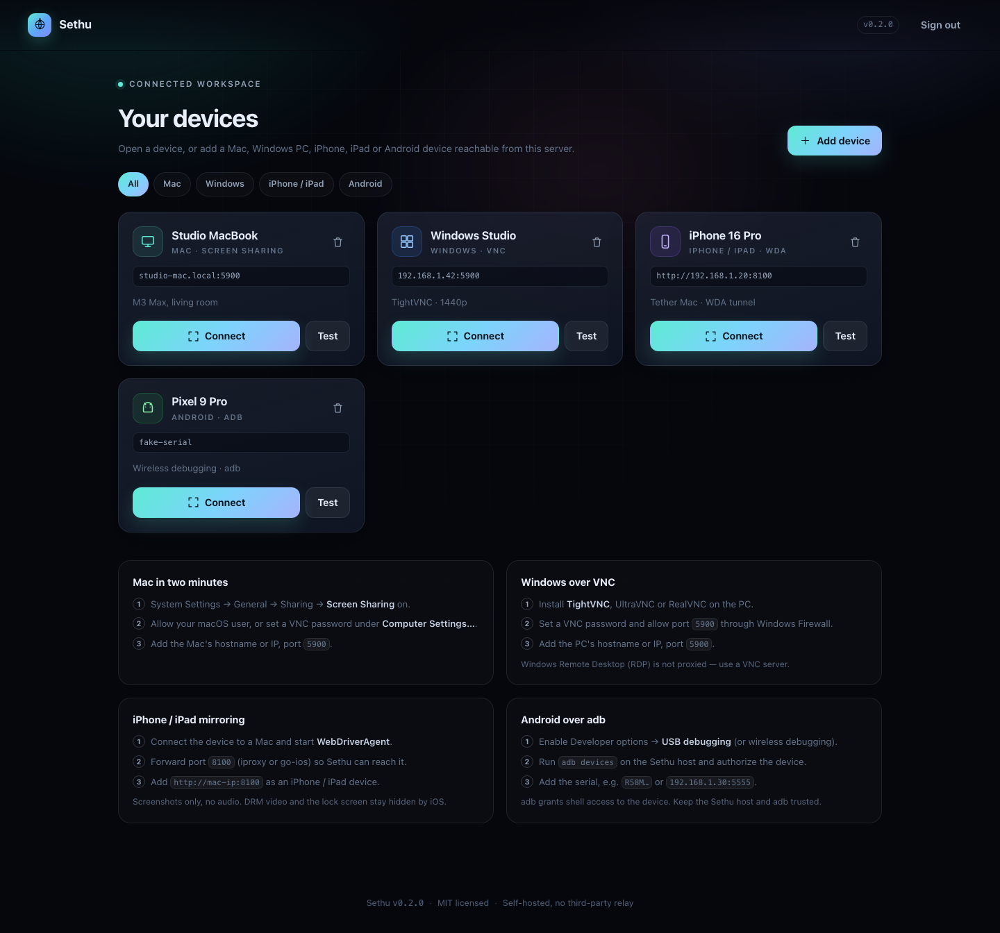
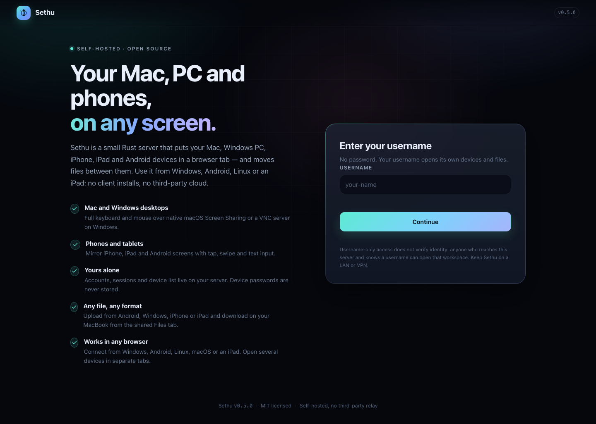
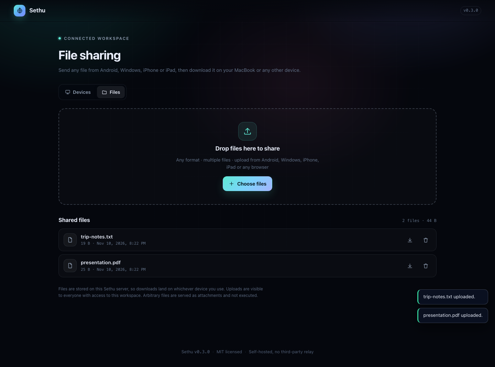

# Sethu

**Your Mac, PC and phones, on any screen.**

Sethu is a self-hosted, MIT-licensed remote-access gateway written in Rust. It
puts your desktops and mobile devices inside a browser tab so you can use them
from Windows, macOS, Linux, Android or an iPad — without installing a client or
sending traffic through someone else's cloud.

```
Windows / Android / iPad / Linux
        │  HTTPS + WSS
        ▼
  ┌───────────────────┐
  │   Sethu (Rust)    │  accounts · sessions · CSRF · rate limits
  └─────────┬─────────┘
            │
   ┌────────┼─────────────────────┬──────────────────────┐
   ▼ RFB (VNC)                    ▼ screenshots + WDA     ▼ screenshots + adb
macOS Screen Sharing :5900   WebDriverAgent :8100     adb (USB / Wi-Fi)
Windows VNC server  :5900    ──► iPhone / iPad        ──► Android phone / tablet
```

| Device | What you get | Transport |
| --- | --- | --- |
| **Mac / MacBook** | Full desktop, keyboard and mouse, clipboard, scaling, view-only mode | RFB over a WebSocket-to-TCP bridge (noVNC in the browser) |
| **Windows PC** | Full desktop and input through any VNC server (TightVNC, UltraVNC, RealVNC) | Same RFB bridge as macOS |
| **iPhone / iPad** | Live screen, tap, swipe, text input, home/lock buttons, screenshot download, 4–15 fps | PNG frames and WDA commands over WebSocket |
| **Android phone / tablet** | Live screen, tap, swipe, text input, home/back/recents/power, screenshot download, 3–12 fps | PNG frames from `adb screencap` and `adb shell input` |
| **Files** | Upload and download any format between your devices from the **Files** tab, or send a file straight to another device that is online | Multipart uploads to the Sethu server, streamed downloads and server-relayed device transfers |

Everything runs on one small binary. Accounts, device list and sessions live in
a single JSON file on your server. Sethu never stores device credentials — they
travel from the browser to the device through the encrypted tunnel.



> **Scope, honestly:** macOS and Windows expose screen sharing through VNC
> (macOS Screen Sharing, or a VNC server on Windows). Windows RDP is not
> proxied. iPhone/iPad mirroring uses WebDriverAgent and Android uses adb; both
> poll screenshots, so there is no audio, no DRM video and a low frame rate. See
> [Limitations](#limitations).

---

## Quick start

Requirements: Rust 1.82+ and one or more reachable devices. For Android
mirroring, install Android platform-tools (`adb`) on the Sethu host.

```bash
git clone https://github.com/maker224/sethu.git
cd sethu
cargo run --release
```

Open <http://localhost:8080> and pick a username. In username mode there is no
password and no separate registration: a new name gets an empty workspace, and
the same name brings back its devices and files. Then add a device.

### Sign-in modes

| `SETHU_AUTH` | Behaviour |
| --- | --- |
| `required` (default) | Email + password, account registration, Argon2id hashing |
| `username` | Username only — no password, no registration; unknown names create a workspace |
| `open` | No sign-in at all; everyone shares the first workspace |

```bash
SETHU_AUTH=username cargo run --release
```



Username mode still creates an HttpOnly session and keeps CSRF protection, but it
does **not verify identity**: anyone who can reach the server and knows a
username can open that workspace. Prefer `required` on the open internet; use
`username` or `open` only on a trusted LAN or VPN. If you switch from open mode
and want to keep the existing data, sign in with the old account's email as the
username.

During development, serve the frontend from disk so edits are instant:

```bash
SETHU_WEB_DIR=./web RUST_LOG=sethu_server=debug cargo run
```

### Connect by QR code

On the MacBook/Windows browser, click **Pair a phone** (or the QR icon on a
device card). Scan the code:

- with the phone's Camera app, or
- inside Sethu on the phone: **Scan a QR code instead** (sign-in screen) or
  **Scan QR** (dashboard) — live camera over HTTPS, or take/choose a photo on a
  plain-HTTP LAN address, or paste the link.

A workspace code signs the phone into the same workspace. A **device card's QR**
opens that Mac/Windows/iPhone/Android viewer directly — use that when you want
to connect to a machine, rather than just signing in.

The code is single-use and expires after 2 minutes
(`SETHU_PAIR_TTL_SECONDS`). The phone first sees a confirmation page and the code
is only consumed after it continues, so link previews can't burn it. Scanning
grants a session, so only show it to a device you control. The desktop pairing
window closes itself as soon as the phone finishes connecting. If the desktop is
on `localhost`, Sethu substitutes the Mac's LAN IP so the phone can reach it;
otherwise set `SETHU_PUBLIC_URL` to the address phones use.

The in-app scanner is intentionally **phone/tablet only**. Mac and Windows
desktops show the QR code and hide the scanner controls; phones and tablets show
**Scan QR** and hide the “Pair a phone” QR-display controls. On plain HTTP, the
phone's browser cannot use the camera API, so take/choose a photo of the QR or
paste the link (or use the phone's Camera app, which needs no permission).

### Stable wireless sessions

Once a phone has scanned a code and opened a viewer, Sethu keeps the session
alive without asking you to reload:

- VNC and screenshot streams auto-reconnect with backoff after Wi-Fi drops,
  server restarts, proxy timeouts or tab backgrounding.
- The server sends VNC WebSocket pings; screenshot viewers send a heartbeat and
  replace a stream that has gone silent for ~8 seconds.
- Returning to the tab or regaining network reconnects immediately.
- VNC credentials are cached **in page memory only** for seamless re-auth and
  cleared when the viewer closes.
- On HTTPS phones/tablets a screen wake-lock keeps the display on during an
  active session.

QR pairing itself is a one-time handoff; the reconnects reuse the HttpOnly
session cookie, so you do not need to rescan after an interruption.

### Docker

```bash
cp .env.example .env       # set SETHU_PUBLIC_URL / secrets
docker compose up -d --build
```

Data persists in the `sethu-data` volume. Put a TLS-terminating proxy in front
before exposing it, and read [Security](SECURITY.md) first. For an offline
install, mount a vendored noVNC directory and set `SETHU_VENDOR_DIR` to it.

### Deploy on a free server (Render)

[](https://render.com/deploy?repo=https://github.com/maker224/sethu)

`render.yaml` provisions a free Docker web service with HTTPS, WebSockets and
username-only sign-in. Render injects `PORT` and `RENDER_EXTERNAL_URL`; Sethu
uses both automatically, so no extra URL configuration is needed.

Free-tier caveats:

- The instance sleeps after inactivity and cold-starts on the next request.
- The filesystem is **ephemeral**: accounts, devices and uploaded files reset on
  restart/deploy. Use a paid disk, Fly.io with a volume, or a VPS for real data.
- There is no adb/WebDriverAgent access from the cloud host, so device mirroring
  needs a self-hosted instance on your LAN. File sharing and the UI work fully.

For a persistent deployment, use the supplied `Dockerfile` on Fly.io (with a
volume mounted at `/data`), Railway, or a small VPS behind Caddy; keep
`SETHU_DATA_DIR` on persistent storage.

---

## Connect a Mac

1. On the Mac: **System Settings → General → Sharing → Screen Sharing** on.
2. Choose how Sethu should sign in:
   - **Your macOS account (recommended).** Under *Allow access for*, add your
     user. Sethu prompts for your Mac username and password using Apple Remote
     Desktop authentication.
   - **A VNC password.** Click the ⓘ → **Computer Settings…** → enable
     **VNC viewers may control screen with password**. This avoids typing your
     account password into a browser, but the VNC secret is limited to 8
     characters.
3. Allow Screen Sharing through the macOS firewall. Verify from the Sethu host:

   ```bash
   nc -vz studio-mac.local 5900
   ```

4. In Sethu, **Add device → Mac**, enter `studio-mac.local` (port defaults to
   5900). **Test** should report a TCP handshake.
5. **Connect** and sign in. Sethu never stores the credentials; they travel from
   the browser to the Mac through the encrypted WebSocket.

`scripts/enable-macos-screen-sharing.sh` automates the sharing toggle (it uses
Apple's `kickstart` tool and asks for `sudo`); it does not guess or store the
VNC password.

---

## Connect a Windows PC

Sethu speaks standard RFB, so any Windows VNC server works.

1. Install [TightVNC](https://www.tightvnc.com/), UltraVNC or RealVNC on the PC.
2. Set a VNC password and allow port `5900` through Windows Firewall.
3. Verify from the Sethu host:

   ```bash
   nc -vz desktop-pc.local 5900
   ```

4. In Sethu, **Add device → Windows**, enter `desktop-pc.local:5900`.
5. **Connect** and enter the VNC password.

Windows Remote Desktop (RDP) is a different protocol and is not proxied — install
a VNC server if you want browser access. The same VNC authentication caveats as
macOS apply: use a strong password and keep port 5900 off the public internet.

---

## Connect an Android phone or tablet

Sethu uses `adb` for both screenshots and input. Enable **Developer options →
USB debugging** (or **Wireless debugging**) and authorize the computer running
Sethu.

```bash
adb devices
# List of devices attached
# R58M1234567    device
# 192.168.1.30:5555    device
```

Install platform-tools on the Sethu host (`brew install android-platform-tools`,
`apt install adb`, or the official SDK). Then **Add device → Android** and enter
the serial exactly as shown — for example `R58M1234567` or
`192.168.1.30:5555`. **Test** reports the adb state and **Connect** opens the
screen.

Notes:

- USB debugging gives adb shell access to the device. Treat the Sethu host as a
  trusted machine and do not expose port 5555 or the adb server to the internet.
- Android input text goes through `adb shell input text`, which has a limited
  character set. Sethu accepts letters, digits, spaces and common punctuation.
- Wireless debugging uses a changing port; reconnect and update the serial if it
  rotates.
- In Docker, install `adb` in the image (or a sidecar) and use network debugging.
  USB devices need explicit host device mapping.

---

## Connect an iPhone or iPad

Sethu talks to [WebDriverAgent][wda] (the XCTest runner used by Appium). No
Appium server is required — Sethu calls WDA's session-less endpoints directly.

1. On a Mac with Xcode: build and run WebDriverAgent for your device. The helper
   script clones and runs it:

   ```bash
   ./scripts/start-wda.sh <device-udid>
   # or set WDA_DIR / DEVELOPMENT_TEAM_ID and run it again
   ```

2. WDA listens on the device at port 8100. Expose it to the Sethu process with
   `iproxy` (or `go-ios`):

   ```bash
   iproxy 8100 8100 <device-udid>
   ```

   Easiest setup: run Sethu **on the same Mac** and add `http://127.0.0.1:8100`.
   On iOS 17+ XCTest communication needs the userspace tunnel; `go-ios` and
   `pymobiledevice3` provide it.

3. Verify: `curl http://127.0.0.1:8100/status` returns `"ready": true`.

4. In Sethu, **Add device → iPhone / iPad**, enter the base URL, for example
   `http://192.168.1.20:8100`.

> **WDA has no authentication.** Anyone who can reach port 8100 controls the
> phone. Keep it on loopback, a private LAN or a VPN — never expose it to the
> internet. Sethu adds accounts and TLS on top, but WDA itself is the trust
> boundary.

Gesture mapping: a short press is a tap; a drag becomes a WDA
`dragfromtoforduration` gesture; **Type** sends text via `/wda/keys`. Screenshot
pixels are converted to logical points using the scale reported by
`/wda/screen`.

[wda]: https://github.com/appium/WebDriverAgent

---

## Share files between devices

The **Files** tab is a shared drop box on the Sethu server. It accepts any
format, multiple files at once, and works in both directions from every
browser:

1. Run Sethu on the MacBook (or on a server both devices can reach).
2. On **any** device — MacBook, Android, Windows, iPhone/iPad — open
   `http://<sethu-host>:8080` → **Files** → upload.
3. On another device open the same page → **Files** → download. On each file,
   **Share** also gives you a copyable link and, for Android, a direct push.

### Send to a device that is online (any network)

The **Files** tab shows which of your devices are online right now. This is a
browser presence check, not a LAN scan: each device keeps a small heartbeat to
the Sethu server, so the two devices only have to reach the server — they do
**not** have to share a Wi-Fi network or be able to reach each other.

1. Open Sethu on both devices and sign in with the same username. Give each one
   a name with **Rename** in the Files tab ("MacBook", "iPhone", "Work PC").
2. On the sending device: **Files** → **Share** on a file → **Send to…** under
   *Send to an online device*.
3. On the receiving device: **Files** → **Device transfers** → **Receive**. The
   download starts and the file is added to that device.

If either device is offline, the send is refused with an explanation. A pending
transfer expires after 10 minutes (`SETHU_TRANSFER_TTL_SECONDS`) if the receiver
never accepts it, and only a received transfer can be downloaded. Both tabs need
to stay open while the transfer is pending; closing the tab marks the device
offline after the presence TTL (`SETHU_PRESENCE_TTL_SECONDS`).

| Scenario | Works because |
| --- | --- |
| **Android → MacBook** | Android Chrome uploads; the MacBook downloads from the same list |
| **Windows → MacBook** | Same flow from Edge/Chrome on Windows |
| **Android + Windows → MacBook** | Both upload into the same workspace list |
| **iPhone/iPad → MacBook** | Safari's file picker uploads Photos, Files or camera captures |
| **MacBook → Android (different network)** | **Share → Send to** an online Android device; receive it there in Files |
| **iPhone → MacBook (different network)** | Same online-device transfer in either direction |
| **MacBook → Android (same LAN, adb)** | **Share → Send directly to Android** pushes it to `/sdcard/Download/` |
| **MacBook → Windows** | Upload on the MacBook, then **Share → Copy** and open the link in the Windows browser |
| **MacBook → any browser** | Copy the download link from **Share** and open it on the other device |



Behaviour:

- Contents stream to `data/files/<workspace>/<uuid>`; metadata lives in
  `sethu.json`. Empty files are allowed.
- The default maximum is 2 GiB per file (`SETHU_MAX_FILE_BYTES`).
- **Share** on a file copies an authenticated download link for Windows or any
  browser. For a connected Android device, **Send to Android** runs
  `adb push` into its public Downloads folder (no download step on the phone).
  Direct push needs adb on the Sethu host and the device authorized; the copy
  link works everywhere.
- **Send to an online device** relays the file through the Sethu server. It is
  refused unless both the sending and receiving browsers are online in the same
  username workspace, and it waits for the receiver to press **Receive**. It
  works across networks because only the server has to be reachable. Presence
  and transfers are in memory, so a server restart marks devices offline and
  drops pending transfers; uploaded files themselves are unaffected.
- Transfers are scoped to one workspace and one recipient device. The receiver
  cannot download before accepting, and a transfer link from another username
  returns 404.
- Downloads are forced `Content-Disposition: attachment` with `nosniff`, so an
  uploaded HTML or SVG cannot execute on the Sethu origin.
- Files are visible only inside their own username workspace. If you sign out
  and sign in as someone else, the previous file list is cleared from memory and
  from the page, the server returns that user's own files only, and old download
  links return 404. `SETHU_AUTH=open` is the exception: everyone shares the
  first workspace by design.
- Files are visible to everyone with access to the workspace and are **not**
  end-to-end encrypted. The server stores them in plaintext on disk; anyone who
  controls the server or its backups can read them. Delete files from the list
  when you no longer need them.
- If Sethu runs on a remote Linux VPS, files land on that VPS, not directly in
  the MacBook filesystem. Run Sethu **on the MacBook** for the exact
  “phone → MacBook folder” flow.

---

## Configuration

All settings are environment variables (or an `.env` file for Docker Compose).
See `.env.example`.

| Variable | Default | Purpose |
| --- | --- | --- |
| `SETHU_BIND` | `0.0.0.0:8080` | Listen address |
| `SETHU_DATA_DIR` | `./data` | Directory for `sethu.json` (mode 0600) |
| `SETHU_PUBLIC_URL` | – | Canonical URL, e.g. `https://remote.example.com`; required behind a proxy |
| `SETHU_COOKIE_SECURE` | auto (`true` with an `https://` public URL) | Marks the session cookie `Secure` |
| `SETHU_AUTH` | `required` | `required`, `username` (no password) or `open` (no sign-in; trusted LAN only) |
| `SETHU_MAX_FILE_BYTES` | `2147483648` | Maximum size of one uploaded file |
| `SETHU_PAIR_TTL_SECONDS` | `120` | QR pairing code lifetime (30–600) |
| `SETHU_PRESENCE_TTL_SECONDS` | `45` | How long a device stays “online” after its last heartbeat (15–300) |
| `SETHU_TRANSFER_TTL_SECONDS` | `600` | How long a pending device transfer waits for **Receive** (60–3600) |
| `SETHU_ALLOW_REGISTRATION` | `true` | Set `false` after creating your account |
| `SETHU_SESSION_TTL_HOURS` | `168` | Login lifetime |
| `SETHU_IOS_FPS` | `10` | Default iPhone/iPad frame rate (1–15) |
| `SETHU_ANDROID_FPS` | `5` | Default Android frame rate (1–15) |
| `SETHU_ADB_PATH` | `adb` | Path to the adb executable |
| `SETHU_ADB_TIMEOUT_SECONDS` | `10` | Per-command adb timeout |
| `SETHU_TRUST_PROXY` | `false` | Trust `X-Forwarded-For` / `X-Forwarded-Host` from a local proxy |
| `SETHU_ALLOWED_ORIGINS` | – | Extra comma-separated browser origins |
| `SETHU_WDA_TIMEOUT_SECONDS` | `6` | Per-request timeout for WebDriverAgent |
| `SETHU_VNC_CONNECT_TIMEOUT_SECONDS` | `10` | TCP connect timeout for VNC |
| `SETHU_MAX_SESSIONS` | `32` | Maximum concurrent device streams |
| `SETHU_WEB_DIR` | – | Serve frontend files from disk (development) |
| `SETHU_VENDOR_DIR` | `./web/vendor` | Optional third-party assets (vendored noVNC) |
| `RUST_LOG` | `sethu_server=info` | `tracing` filter |

### Reverse proxy + TLS

Sethu speaks plain HTTP so a proxy can own certificates. Example Caddy config in
[`deploy/Caddyfile`](deploy/Caddyfile):

```
remote.example.com {
    encode zstd gzip
    reverse_proxy 127.0.0.1:8080 {
        flush_interval -1
    }
}
```

Then set:

```dotenv
SETHU_PUBLIC_URL=https://remote.example.com
SETHU_COOKIE_SECURE=true
SETHU_TRUST_PROXY=true
```

`flush_interval -1` matters for screen sharing: it disables proxy buffering so
WebSocket frames are not delayed.

### systemd

```bash
sudo useradd --system --home /var/lib/sethu sethu
sudo install -d -o sethu -g sethu /var/lib/sethu
sudo install -m 0644 deploy/sethu.service /etc/systemd/system/sethu.service
sudo install -m 0600 .env.example /etc/sethu/sethu.env   # edit first
sudo systemctl enable --now sethu
```

---

## HTTP API

The frontend is a static client of this JSON API. All browser mutations require
the `x-sethu-csrf` header returned by `GET /api/session`; the session cookie is
`HttpOnly; SameSite=Strict`.

| Method | Path | Description |
| --- | --- | --- |
| `GET` | `/api/health` | Liveness, version |
| `GET` | `/api/session` | Current user, CSRF token, registration flag |
| `POST` | `/api/auth/register` | Create account (`email`, `password`; secure mode only) |
| `POST` | `/api/auth/login` | Sign in (`username` in username mode; email/password otherwise) |
| `POST` | `/api/auth/logout` | Revoke the session |
| `GET` | `/api/hosts` | List your devices |
| `POST` | `/api/hosts` | Add device (`name`, `kind`: `macos`\|`windows`\|`ios`\|`android`, `target`, `notes`) |
| `GET` | `/api/hosts/{id}` | One device |
| `PATCH` | `/api/hosts/{id}` | Rename or edit notes |
| `DELETE` | `/api/hosts/{id}` | Remove device |
| `POST` | `/api/hosts/{id}/test` | TCP check (Mac/Windows), WDA `/status` (iPhone) or `adb get-state` (Android) |
| `GET` | `/api/files` | List shared files in the workspace |
| `POST` | `/api/files` | Multipart upload (`file` field, any format) |
| `GET` | `/api/files/{id}/download` | Streamed attachment download |
| `POST` | `/api/files/{id}/send` | Push a file to an Android device's Downloads (`host_id`) |
| `POST` | `/api/files/{id}/transfer` | Queue a file transfer to an online device (`from_device`, `to_device`) |
| `DELETE` | `/api/files/{id}` | Delete a file and its contents |
| `POST` | `/api/presence` | Announce this browser as an online device (`device_id`, `name`) |
| `GET` | `/api/presence` | List online devices in the workspace |
| `DELETE` | `/api/presence/{device_id}` | Leave the online list immediately |
| `GET` | `/api/transfers` | List this workspace's pending/received transfers |
| `POST` | `/api/transfers/{id}/accept` | Receive a transfer (`device_id` must be the recipient) |
| `POST` | `/api/transfers/{id}/cancel` | Cancel a pending transfer (`device_id` must be the sender) |
| `GET` | `/api/transfers/{id}/download` | Download a received transfer |
| `POST` | `/api/pair` | Create a short-lived QR pairing link (`host_id` optional) |
| `GET` | `/api/pair/{token}` | Pairing status (`pending`/`redeemed`/`expired`), owner only |
| `GET` | `/pair/{token}` | Confirmation page (link previews can't consume the token) |
| `POST` | `/pair/{token}` | Redeem the code and set a session |
| `GET` (WS) | `/ws/vnc/{id}` | Raw RFB byte stream (macOS and Windows) |
| `GET` (WS) | `/ws/ios/{id}` | PNG frames + JSON commands (iPhone/iPad) |
| `GET` (WS) | `/ws/android/{id}` | PNG frames + JSON commands (Android) |

WebSocket details and the iPhone/Android message schemas are documented in
[`ARCHITECTURE.md`](ARCHITECTURE.md).

---

## Security model

- **Argon2id** password hashing, constant-time verification and equalised
  timing for unknown emails.
- **Sessions** are 256-bit random tokens; only SHA-256 hashes are persisted.
  Cookie is `HttpOnly`, `SameSite=Strict`, optionally `Secure`.
- **CSRF** double-submit tokens on every unsafe request; **Origin/Host** checks
  also protect WebSocket upgrades.
- **Rate limiting** per IP on login and registration.
- **No stored device credentials.** VNC passwords and account credentials go
  from the browser to the device through the encrypted WebSocket; Sethu never
  parses or stores them. As the TLS endpoint, the server process could in
  principle intercept the stream — run it on hardware you trust.
- **Open access is a deliberate downgrade.** With `SETHU_AUTH=open` there is no
  sign-in and everyone who reaches the port shares one workspace. Keep it on a
  VPN or trusted LAN, or put an authenticating proxy in front.
- **Username-only mode does not verify identity.** With `SETHU_AUTH=username`,
  a username is a name, not a credential; anyone can type someone else's name
  and enter their workspace. Sessions and CSRF still protect the API, but there
  is no authentication. Use it only on a trusted network.
- **Uploads** are plain files on disk, served as attachments. Sethu does not
  scan for malware; treat uploads as untrusted and keep the data directory
  private (mode `0600`).
- **QR pairing grants a session.** A pairing code is a short-lived credential:
  anyone who scans it (or copies the link) gets access to that workspace or
  device. Keep the screen private and regenerate if it leaks.
- **Hardened headers**: CSP, `X-Frame-Options: DENY`, `nosniff`, no-referrer,
  restrictive permissions policy.
- The data file is written atomically with mode `0600`; back it up and protect it.

Sethu is not a zero-trust product. A compromised Sethu server, or an account
with access to a device, can control that device. Deploy it on a trusted network
or behind a VPN, terminate TLS, disable registration after onboarding, keep WDA
bound to loopback and remember that adb grants shell access. Full threat model:
[`SECURITY.md`](SECURITY.md).

---

## Development

```
crates/sethu-server/
  src/
    main.rs        binary, config, graceful shutdown
    lib.rs         router assembly
    api.rs         JSON API (auth + devices)
    auth.rs        Argon2, cookies, CSRF, AuthUser extractor
    security.rs    origin checks, rate limits, hardening headers
    store.rs       JSON persistence (users, hosts, hashed sessions)
    target.rs      device address validation
    wda.rs         WebDriverAgent client
    adb.rs         Android adb client
    files.rs       shared file uploads/downloads
    ws/vnc.rs      RFB <-> WebSocket bridge
    ws/ios.rs      iPhone screenshot/command bridge
    ws/android.rs  Android screenshot/command bridge
    assets.rs      compiled-in frontend
    web.rs         static serving
web/               vanilla ES modules + CSS, no build step
scripts/           macOS / WDA / noVNC helpers
deploy/            systemd + Caddy examples
```

```bash
cargo fmt --all -- --check
cargo clippy --workspace --all-targets -- -D warnings
cargo test --workspace
SETHU_WEB_DIR=./web cargo run
```

The frontend has no bundler or npm dependency. noVNC is loaded from a vendored
copy when present, otherwise from jsDelivr. For an offline install:

```bash
./scripts/vendor-novnc.sh
```

Contributions are welcome — see [`CONTRIBUTING.md`](CONTRIBUTING.md).

---

## Limitations

- **macOS auth:** Screen Sharing must be enabled. Both the macOS account (Apple
  Remote Desktop auth) and the legacy VNC password are supported; the VNC
  password is capped at 8 characters by the protocol.
- **Windows:** requires a third-party VNC server; RDP is not proxied.
- **iPhone capture:** WDA screenshots are polled, not a video stream. Expect
  4–15 fps, no audio, no DRM video, and no lock screen or passcode UI.
- **Android capture:** `adb screencap` polling gives 3–12 fps, no audio and no
  DRM video. `adb shell input text` supports a limited character set.
- **WDA setup:** needs Xcode and a signed runner. On iOS 17+ XCTest needs a
  userspace tunnel (`go-ios`/`pymobiledevice3`).
- **ADB setup:** needs platform-tools on the Sethu host and an authorized
  device. USB access from inside a container needs extra device mapping; Wi-Fi
  debugging is simpler for Docker deployments.
- **No built-in TLS:** use Caddy, nginx or Traefik (examples included).
- **Single-user devices:** devices belong to the account that added them; no
  sharing between accounts yet.
- **No peer-to-peer or end-to-end encrypted file transfer**, audio, multi-monitor
  selection, RDP or recording in v0.4. Files live in a shared server workspace;
  online device transfers are relayed through that server, not peer-to-peer.
  Android pushes use adb and everything else uses the browser.

### Roadmap

- Native macOS agent (ScreenCaptureKit + H.264/WebRTC) for stronger auth and
  lower latency
- scrcpy-style Android H.264 streaming instead of screenshot polling
- RDP gateway for Windows (xrdp/freeRDP) alongside VNC
- iPhone video streaming via an MJPEG/H.264 pipeline
- TOTP / WebAuthn second factor and audit log
- Per-device sharing with expiring links
- iOS 17+ tunnel helper built into Sethu
- Session recording and clipboard sync improvements

---

## License

MIT © Sethu contributors. noVNC (loaded client-side) is MPL-2.0; WebDriverAgent is
BSD-3-Clause. See [`LICENSE`](LICENSE).
